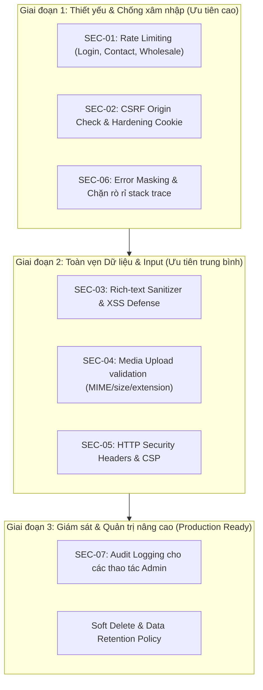

# KẾ HOẠCH BẢO MẬT HỆ THỐNG (SECURITY PLAN) — X-ON NAIL SHOP
> **Trạng thái**: `PLAN ONLY` — Dựa trên phân tích đối chiếu với Spec `XON_Technical_Spec_Demo.docx.md` (Mục 1.2 & Mục 10). **Tuyệt đối chưa sửa đổi codebase**.

---

## I. TỔNG QUAN & ĐỐI CHIẾU VỚI SPEC

### 1. Phân loại vai trò người dùng (Spec §1.2)
* **Guest**: Xem công khai (Home, Shop, Gallery, Blog), gửi form Contact & Wholesale. Không có session.
* **Registered Customer** (`Customer`): Đăng nhập/đăng ký tài khoản mua lẻ, quản lý profile cá nhân khi mở rộng.
* **Wholesale Applicant / Partner** (`Wholesale`): Gửi đơn đăng ký đối tác bán buôn, truy cập bảng giá/chính sách wholesale.
* **Admin** (`Admin`): Quản trị toàn bộ dữ liệu, CRUD Product, Gallery, Inquiries, Orders, Users.

### 2. Yêu cầu kỹ thuật phi chức năng về bảo mật (Spec §10)
| Hạng mục trong Spec | Chi tiết yêu cầu kỹ thuật | Trạng thái hiện tại |
| :--- | :--- | :--- |
| **Server-side validation** | Validation dữ liệu đầu vào ở backend cho toàn bộ form và API | Cần hoàn thiện schema Zod ở các route public |
| **Sanitize rich text** | Làm sạch HTML/Rich Text khi biên tập nội dung Blog/Product description | **Còn thiếu** — chưa có cơ chế strip XSS tags |
| **Secure auth / session** | Token/Cookie an toàn, chống giả mạo session, bảo vệ Admin | Đã chặn auth bypass; cần siết cookie flags |
| **Role-based admin access** | Chặn truy cập trái phép bằng phân quyền chặt chẽ (`Admin` duy nhất) | **Đã xử lý cơ bản** ở Phase 2 (default-deny, staff=Admin) |
| **CSRF protection** | Chống tấn công giả mạo yêu cầu từ trang thứ ba | **Còn thiếu** trên các endpoint mutation (POST/PUT/DELETE) |
| **Rate limiting** | Giới hạn tần suất request cho Login, Contact, Wholesale | **Còn thiếu** — có nguy cơ spam/brute-force |
| **Media validation** | Kiểm tra MIME type, dung lượng file, chống upload tệp độc hại | **Còn thiếu** validation nghiêm ngặt |
| **Data integrity / Audit** | Ngăn chặn mass-assignment, log hành động quản trị viên | Đã chặn mass-assignment ở 5 route; thiếu audit log |

---

## II. CÁC HẠNG MỤC ĐÃ ĐƯỢC XỬ LÝ (TÓM TẮT TIẾN ĐỘ)
1. **S-01 / S-02 (Role Guards & RBAC Default-Deny)**:
   - Đã chuẩn hóa cơ chế `requireAuth`: mặc định từ chối (`default-deny`), vai trò staff chỉ chấp nhận duy nhất `"Admin"`.
   - Bảo vệ an toàn các route nhạy cảm của Admin.
2. **S-05 (Mass Assignment Protection)**:
   - Đã áp dụng whitelist các trường cho phép cập nhật tại `contact`, `customers/[id]`, `orders/[id]`, `products/[id]`, và `admin/sidebar-counts`.
   - Ngăn chặn việc client tùy tiện chèn các trường đặc quyền (như tự gán `role = Admin` hoặc đổi `status`).
3. **S-06 (Timing Attack Protection)**:
   - Sử dụng dummy hash compare để thời gian phản hồi khi tài khoản tồn tại hoặc không tồn tại là tương đương nhau, tránh rò rỉ việc người dùng có tồn tại trong hệ thống hay không.

---

## III. CHI TIẾT CÁC BƯỚC BẢO MẬT CÒN THIẾU & GIẢI PHÁP KỸ THUẬT

### 1. SEC-01: Rate Limiting & Chống Brute-Force (Spec §10)
* **Vấn đề & Rủi ro**:
  - Endpoint `/api/auth/login` có thể bị tấn công brute-force mật khẩu.
  - Endpoint public `/api/contact` và `/api/wholesale` có thể bị bot spam gây tràn database hoặc cạn kiệt tài nguyên máy chủ.
* **Giải pháp kỹ thuật**:
  - Triển khai middleware / utility Rate Limiter dạng **Token Bucket / Sliding Window** dựa trên IP client (và email đối với login).
  - Sử dụng Memory-cache (LRU cache) cho môi trường demo / serverless node, thiết kế adapter sẵn sàng kết nối Redis khi deploy production.
  - **Quy tắc cấu hình**:
    - `POST /api/auth/login`: Tối đa **5 lần thử sai / 15 phút** cho mỗi IP/Email. Quá số lần sẽ trả về `HTTP 429 Too Many Requests`.
    - `POST /api/contact`, `POST /api/wholesale`: Tối đa **5 request / 10 phút** cho mỗi IP.
    - Public read endpoints (Shop/Product detail): Tối đa **60 request / phút / IP** (chống dDoS/cào dữ liệu).
* **Đảm bảo không mâu thuẫn Spec**:
  - Không chặn người dùng bình thường duyệt 20 page templates và gửi form hợp lệ.

---

### 2. SEC-02: CSRF Protection & Cookie Hardening (Spec §10)
* **Vấn đề & Rủi ro**:
  - Nếu session cookie được gửi tự động trong các cross-site request, kẻ tấn công có thể lừa admin click vào liên kết độc hại để thực thi lệnh xóa sản phẩm hoặc sửa user.
* **Giải pháp kỹ thuật**:
  - **Cấu hình Cookie Auth**:
    - `httpOnly: true` (chống truy cập từ JavaScript, ngăn đánh cắp qua XSS).
    - `secure: process.env.NODE_ENV === 'production'` (chỉ truyền qua HTTPS khi chạy production).
    - `sameSite: 'lax'` (hoặc `'strict'` cho các phiên quản trị admin).
    - `path: '/'`.
  - **Origin / Referer Verification**:
    - Trong middleware của Next.js, với mọi mutation methods (`POST`, `PUT`, `PATCH`, `DELETE`), kiểm tra header `Origin` / `Referer` phải khớp với domain host của ứng dụng (`process.env.NEXTAUTH_URL` hoặc host nội bộ). Từ chối ngay các request cross-origin lạ.

---

### 3. SEC-03: Input Sanitization & Chống XSS (Spec §10: "sanitize rich text")
* **Vấn đề & Rủi ro**:
  - Nội dung mô tả sản phẩm (Product Description), bài viết Blog, hoặc ghi chú Admin có chứa định dạng rich-text (HTML). Nếu người dùng chèn `<script>`, `onload`, `javascript:` URI sẽ gây mã độc XSS khi render trên frontend.
  - Form Contact / Wholesale nhập văn bản có thể chứa payload script.
* **Giải pháp kỹ thuật**:
  - **Server-side HTML Sanitizer**: Dùng thư viện chuẩn `isomorphic-dompurify` hoặc `sanitize-html` trên backend trước khi lưu vào MongoDB:
    - Whitelist các tag an toàn: `<b>`, `<i>`, `<u>`, `<strong>`, `<em>`, `<p>`, `<br>`, `<ul>`, `<ol>`, `<li>`, `<h3>`, `<h4>`.
    - Strip triệt để: `<script>`, `<iframe>`, `<object>`, `<embed>`, `<link>`, các thuộc tính sự kiện `on*` (`onerror`, `onload`, `onclick`).
  - **Zod Schema Validation**:
    - Xác thực định dạng email (`z.string().email()`), số điện thoại (`z.string().regex(...)`), độ dài string tối đa (`max(500)` cho lời nhắn, `max(100)` cho họ tên) để chống Buffer/Payload Overflow.
    - Escape chuỗi hiển thị trên React bằng việc hạn chế tối đa `dangerouslySetInnerHTML`. Trường hợp bắt buộc dùng cho Blog/Description thì phải đi qua hàm sanitize đã định nghĩa.

---

### 4. SEC-04: Bảo Mật Upload Tệp & Media Validation (Spec §10: "Upload validation theo MIME/size")
* **Vấn đề & Rủi ro**:
  - Kẻ tấn công có thể đổi đuôi file `.exe`, `.html`, `.svg` chứa script độc hại thành `.jpg` rồi upload lên hệ thống.
  - Upload file video/ảnh dung lượng quá lớn làm cạn bộ nhớ hoặc tốn chi phí Cloudinary.
* **Giải pháp kỹ thuật**:
  - **MIME & Magic Bytes Validation**:
    - Chỉ cho phép các định dạng ảnh/video phục vụ nail shop: `image/jpeg`, `image/png`, `image/webp`, `video/mp4`, `video/webm`.
    - Cấm tuyệt đối: `.svg` (có nguy cơ XSS qua SVG XML), `.html`, `.exe`, `.sh`, `.php`.
    - Kiểm tra cả `file.mimetype` và header file signature nếu xử lý stream.
  - **Giới hạn dung lượng**:
    - Ảnh sản phẩm / banner: Tối đa **5MB / file**.
    - Video demo ngắn: Tối đa **30MB / file**.
  - **Sanitize Tên File**:
    - Không dùng tên file gốc trực tiếp (tránh path traversal `../../`).
    - Tạo UUID hoặc timestamp hash: `[nanoid()].[ext]`.
  - **Cloudinary Security**:
    - Dùng Cloudinary Signed Uploads (chỉ backend mới có quyền sinh chữ ký `api_sign_request`), không để lộ `api_secret` ra client.

---

### 5. SEC-05: HTTP Security Headers & Content Security Policy (Spec §10: "Browser / Security")
* **Vấn đề & Rủi ro**:
  - Thiếu các header phòng thủ trình duyệt khiến ứng dụng dễ bị Clickjacking (lồng iframe lừa đảo), MIME-sniffing, hoặc thực thi inline script trái phép.
* **Giải pháp kỹ thuật**:
  - Cấu hình security headers tập trung trong `next.config.mjs` hoặc Next.js `middleware.ts`:
    ```ts
    X-Content-Type-Options: nosniff
    X-Frame-Options: DENY
    X-XSS-Protection: 1; mode=block
    Referrer-Policy: strict-origin-when-cross-origin
    Permissions-Policy: camera=(), microphone=(), geolocation=()
    Strict-Transport-Security: max-age=31536000; includeSubDomains (áp dụng khi Production)
    Content-Security-Policy:
      default-src 'self';
      img-src 'self' data: https://res.cloudinary.com https://*.cloudinary.com;
      media-src 'self' https://res.cloudinary.com;
      script-src 'self' 'unsafe-eval' 'unsafe-inline';
      style-src 'self' 'unsafe-inline' https://fonts.googleapis.com;
      font-src 'self' https://fonts.gstatic.com data:;
      connect-src 'self' https://res.cloudinary.com;
    ```
* **Lưu ý**: CSP được cấu hình cho phép Cloudinary (phục vụ ảnh/video sản phẩm) và Google Fonts mà không cản trở tài nguyên frontend.

---

### 6. SEC-06: Ngăn Chặn Rò Rỉ Thông Tin (Information Leakage & Error Masking)
* **Vấn đề & Rủi ro**:
  - Khối `try/catch` hiện tại nếu trả về `error.message` hoặc `error.stack` có thể làm lộ cấu trúc bảng MongoDB, version phần mềm, hoặc chuỗi kết nối.
* **Giải pháp kỹ thuật**:
  - Chuẩn hóa hàm xử lý lỗi API:
    - Trong môi trường `production`: Ẩn toàn bộ stack trace và chi tiết DB driver, chỉ trả về mã lỗi và thông báo thân thiện (ví dụ: `Internal server error`, `Invalid credentials`, `Resource not found`).
    - Chỉ log chi tiết ra server console / error monitoring nội bộ.
  - Tuyệt đối không trả về thông tin mật khẩu, token, hoặc hash kể cả khi bị lỗi.

---

### 7. SEC-07: Audit Logging & Bảo Vệ Toàn Vẹn Dữ Liệu (Spec §10: "Data integrity / Audit")
* **Vấn đề & Rủi ro**:
  - Khi một Admin thực hiện xóa sản phẩm, sửa đơn hàng hoặc thay đổi trạng thái đối tác Wholesale, hệ thống không lưu lại dấu vết ai đã làm và vào thời điểm nào.
* **Giải pháp kỹ thuật**:
  - Xây dựng model hoặc tiện ích ghi log `AdminAuditLog`:
    - Lưu lại: `adminId`, `action` (CREATE, UPDATE, DELETE), `targetEntity` (Product, User, Order, Inquiry), `targetId`, `timestamp`, `ipAddress`.
    - Tuyệt đối **không log** dữ liệu nhạy cảm như password, session token, credit card.
  - Cơ chế **Soft Delete**:
    - Với các thực thể quan trọng (Sản phẩm, Đơn hàng), triển khai flag `isDeleted: boolean` thay vì `deleteOne()` ngay lập tức trong database thực tế, cho phép phục hồi nếu xóa nhầm.

---

## IV. LỘ TRÌNH THỰC HIỆN THEO ĐỘ ƯU TIÊN (PHASED ROADMAP)



### Chi tiết từng giai đoạn:
1. **Giai đoạn 1 (Chống tấn công trực tiếp)**:
   - Triển khai Rate Limiting trên các endpoint xác thực và form công khai.
   - Siết chặt Cookie và Origin Verification cho toàn bộ API mutation.
   - Che giấu chi tiết lỗi kỹ thuật ở API layer.
   - *Thời lượng dự kiến: 1 commit riêng biệt.*

2. **Giai đoạn 2 (Bảo vệ nội dung & Trình duyệt)**:
   - Tích hợp HTML Sanitizer cho các trường mô tả sản phẩm và nội dung blog.
   - Kiểm tra MIME type và dung lượng upload media (ảnh/video).
   - Thêm bộ HTTP Security Headers vào cấu hình Next.js.
   - *Thời lượng dự kiến: 1 commit riêng biệt.*

3. **Giai đoạn 3 (Sẵn sàng cho Production)**:
   - Thiết lập bảng Audit Log cho các hành vi CRUD của Admin.
   - Kích hoạt chế độ kiểm tra và cảnh báo đăng nhập bất thường.
   - *Thời lượng dự kiến: Thực hiện sau khi hoàn tất nghiệm thu demo.*

---

## V. CAM KẾT ĐẢM BẢO TÍNH TOÀN VẸN CỦA HỆ THỐNG
1. **Không phá vỡ luồng Demo**:
   - Tất cả 20 page templates (14 client + 6 admin) tiếp tục hoạt động trơn tru.
   - Không đòi hỏi thêm thông tin phức tạp từ người dùng cuối ngoài các trường đã quy định trong spec.
2. **Không mâu thuẫn Spec**:
   - Khớp 100% với phân quyền 4 vai trò trong Spec §1.2.
   - Đáp ứng đầy đủ các tiêu chuẩn kỹ thuật phi chức năng của Spec §10.
3. **Thực thi minh bạch**:
   - Mỗi giai đoạn đều được thực hiện theo commit độc lập kèm kiểm tra `npm run lint` và `npm run type-check`.
